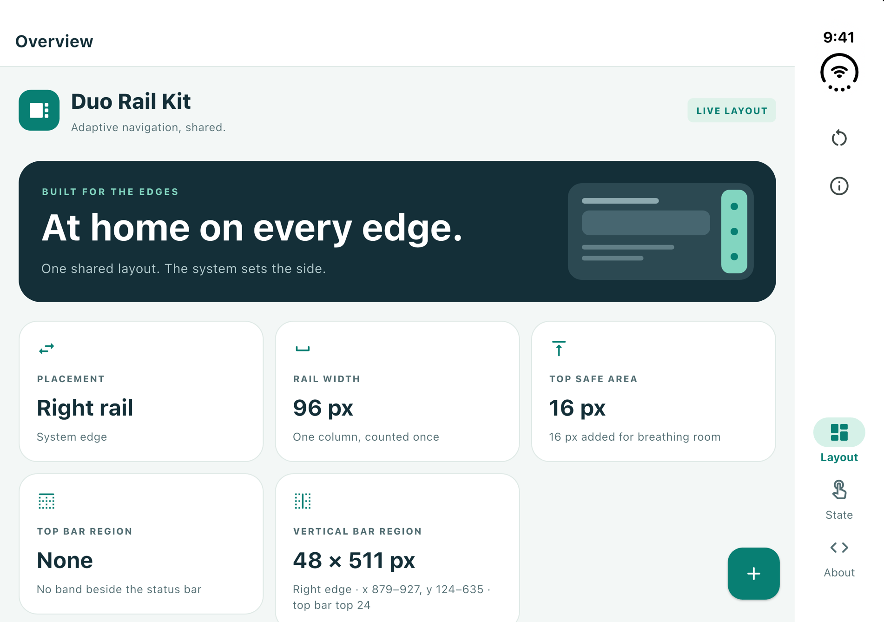
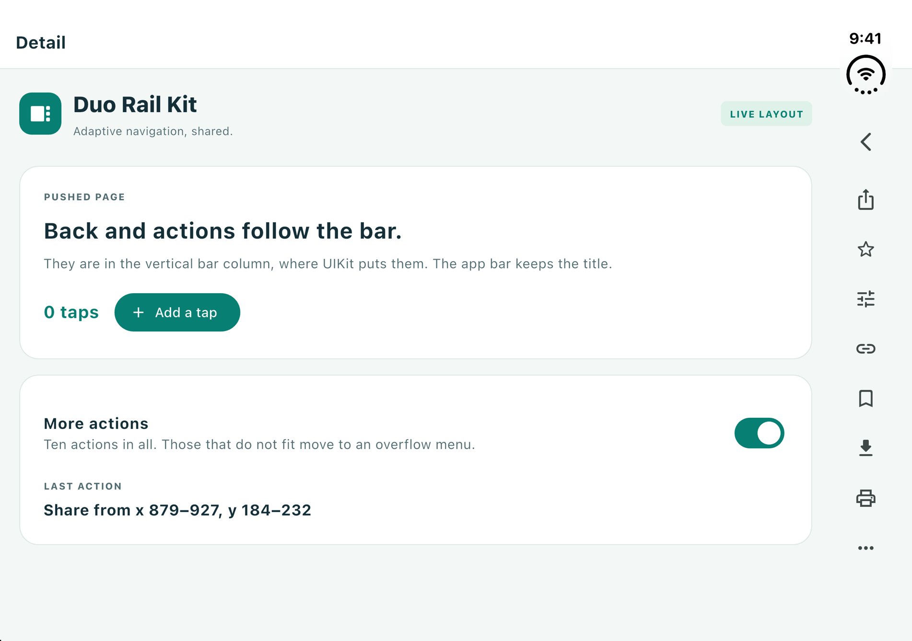
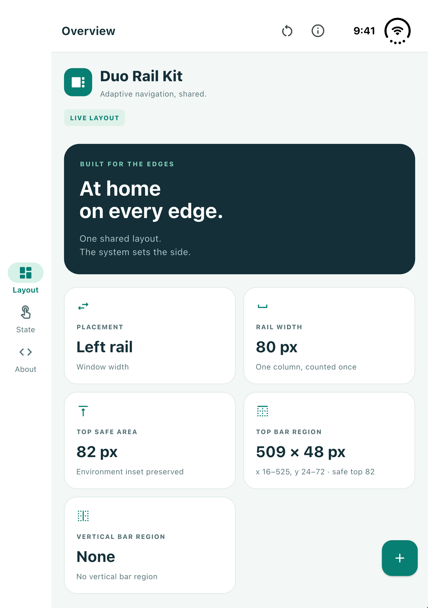
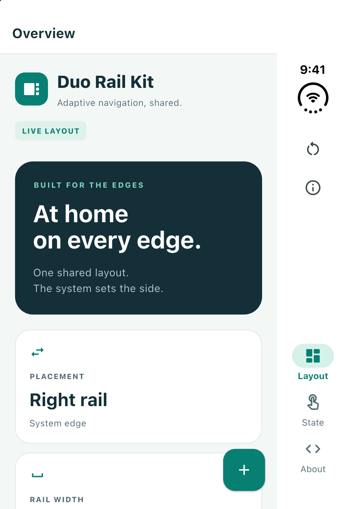
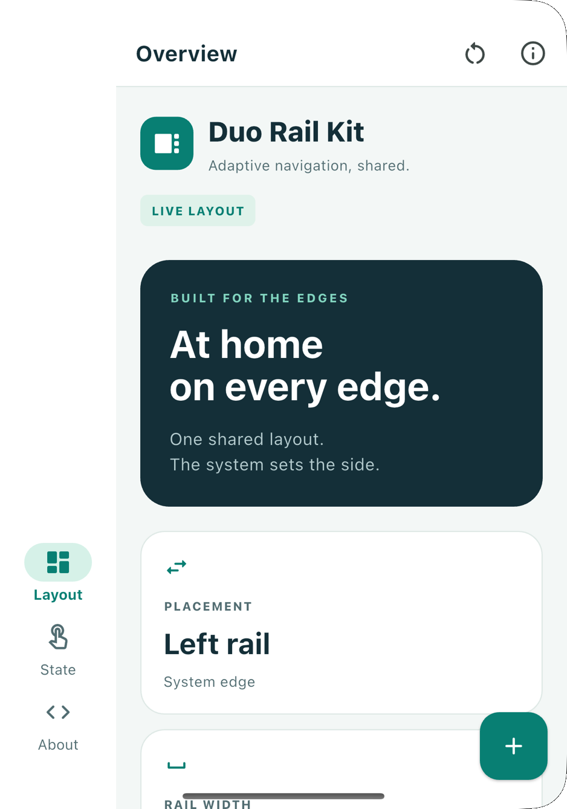
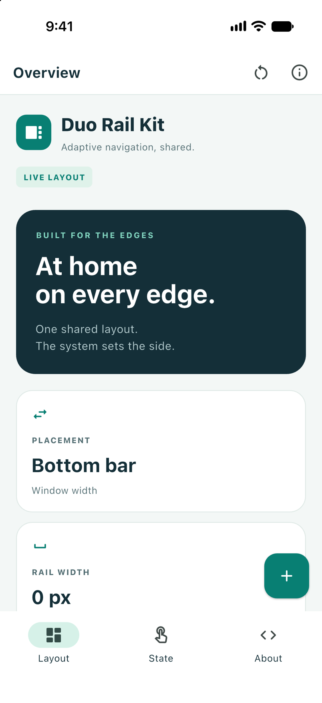

# duo_rail_kit

A Flutter plugin for iPhone Duo: navigation rails on the physical edge iOS
chooses, pushed and tab pages' back controls and actions in the system's
vertical bar where UIKit puts them, the system's bar regions, and safe-area and
FAB helpers. Navigation, styling, breakpoints, grids, SnackBars, overlays, and
content/FAB avoidance stay with the application; the only runtime dependency is
Flutter.

The example on the iOS 27.2 Simulator ([details](doc/images/README.md)):





| Inner portrait: app bar in the top band | Outer display: right rail |
| :---: | :---: |
|  |  |
| **Left Split View app: left rail** | **iPhone 17: bottom bar** |
|  |  |

## Requirements

- Flutter `>=3.47.8`, Dart `^3.12.0`.
- iOS: Swift Package Manager, deployment target 15.0+, no CocoaPods.
- Native compilation: Xcode with the iOS 27.1 SDK, which declares
  `UITraitCollection.verticalBarEdge` and
  `UIView.LayoutRegion.bar(onEdge:extent:)`; runtime access is guarded for
  iOS 27.1.
- Other platforms use the application's width rule; no Android native code.

Flutter's generated registrant registers `DuoRailKitPlugin` (no Xcode edits);
the Swift package needs Flutter's `FlutterFramework`, so build it through a
Flutter iOS host.

## Installation

```yaml
dependencies:
  duo_rail_kit: ^0.2.0
```

Run `flutter pub get` and commit `pubspec.lock`. API docs are on
[pub.dev](https://pub.dev/packages/duo_rail_kit).

## Quick start

Wrap the application once:

```dart
import 'package:duo_rail_kit/duo_rail_kit.dart';
import 'package:flutter/material.dart';

MaterialApp(
  builder: (context, child) => VerticalBarEdge(
    child: SideStatusBarInsets(child: child ?? const SizedBox.shrink()),
  ),
  home: const Scaffold(body: Center(child: Text('Hello'))),
);
```

`SideStatusBarInsets` must be below `VerticalBarEdge`, whose edge it reads.
Keep both mounted whatever the device or layout; changing the wrapper structure
can recreate navigation and page state.

`RailLayout` makes the `RailPlacement` calls a rail needs; read it in the
shell, before changing content insets (the breakpoint and rail width are example
choices):

```dart
final data = MediaQuery.of(context);
final rail = RailLayout.of(
  context,
  showsRailByWidth: (windowWidth) => windowWidth >= 600,
  railWidth: 80,
);
```

The [example app](example/README.md) shows every feature;
[example/lib/app.dart](example/lib/app.dart) is the complete integration.

## Features

Values in this README are logical pixels (iOS points).

### Rails

The example's `_DemoShell` builds this as a `VerticalBarShell`:

```dart
RailSideRow(
  railEdge: rail.edge,
  rail: SizedBox(
    width: rail.occupiedWidth,
    child: MediaQuery(
      data: data.copyWith(padding: rail.centredSafeArea),
      child: NavigationRail(
        minWidth: rail.width,
        groupAlignment: rail.followsSystemBar ? 1 : 0,
        scrollable: true,
        selectedIndex: selectedIndex,
        destinations: destinations,
      ),
    ),
  ),
  content: MediaQuery(data: rail.removeRailEdge(data), child: content),
);
```

- `RailSideRow` neither adjusts safe areas nor draws a rail; keep the wrappers
  around its content stable.
- `centredSafeArea` keeps a system rail's destinations below the status
  display (`RailPlacement.statusColumnBottom`, 152), for a centred rail or a
  bottom-aligned group that can grow (large text, a keyboard).
- Beside content holding a `Navigator` (one per tab branch), a left rail is
  missing from the semantics tree, with `RailSideRow` or `VerticalBarShell`: the
  route's `ModalBarrier` blocks what is painted before it, up to the nearest
  semantics container. Pass
  `content: Semantics(container: true, child: content)`.

### Top safe-area spacing

`SideStatusBarInsets` raises the top `padding` and `viewPadding` to 16 in
windows with a status column and in the left Split View window.

### FAB placement

Always wrap the content in `RailSideFab` and change only `enabled` (the
example's `_DemoShell` and `_DemoContent`):

```dart
RailSideFab(
  enabled: rail.followsSystemBar,
  child: Builder(
    builder: (context) => Scaffold(
      floatingActionButtonLocation: RailSideFab.locationOf(context),
      floatingActionButton: FloatingActionButton(onPressed: () {}, child: const Icon(Icons.add)),
    ),
  ),
);
```

When enabled, the FAB sits 24 above the content bottom.

### Top band

`TopBarRegion.of` returns the top bar region, the band beside the status
display in the Duo inner portrait top safe area; `VerticalBarRegion.of`, the
vertical bar's item region with its `edge` and `topBarTop`
([measured values](#measured-values)).

An `AppBar` in the band needs no height of its own, as the `Scaffold` adds the
full top inset (the example's `_DemoAppBar`):

```dart
class BandAppBar extends StatelessWidget implements PreferredSizeWidget {
  const BandAppBar({super.key, required this.band, required this.pane, required this.title});

  final TopBarRegion? band; // TopBarRegion.of(context), read above the pane
  final Rect pane; // the pane in window coordinates
  final Widget title;

  @override
  Size get preferredSize => Size.fromHeight(band == null ? kToolbarHeight : 0);

  @override
  Widget build(BuildContext context) {
    final band = this.band;
    final data = MediaQuery.of(context);
    return MediaQuery(
      data: band == null ? data : data.copyWith(padding: band.paddingFor(pane)),
      child: AppBar(toolbarHeight: band?.rect.height ?? kToolbarHeight, title: title),
    );
  }
}
```

A full-width pane on inner portrait gets `EdgeInsets.fromLTRB(16, 24, 144, 0)`;
beside a rail, the pane is `rail.contentRect(data.size)`.
`MediaQuery.padding.top` is unchanged, so dialogs keep the full inset. Taps in
the band reach Flutter.

### Pushed-page toolbar

`VerticalBarPage` draws a full-window pushed page's back control and actions in
the vertical bar column and tells its app bar what to leave out. Wrap the page
that a `PageRoute` builds, above its `Scaffold` (the example's `_DetailPage`):

```dart
class ArticlePage extends StatelessWidget {
  const ArticlePage({super.key, required this.onShare});

  final void Function(Rect? origin) onShare; // origin in window coordinates, or null

  @override
  Widget build(BuildContext context) => VerticalBarPage(
    actions: [
      VerticalBarAction(
        id: 'share',
        icon: const Icon(Icons.ios_share),
        label: 'Share',
        onPressed: (invocation) => onShare(invocation.anchor),
      ),
    ],
    builder: (context, slots) => Scaffold(
      appBar: AppBar(
        automaticallyImplyLeading: !slots.backInColumn,
        centerTitle: slots.active ? false : null, // leading, as in UIKit
        title: const Text('Article'),
        actions: slots.active
            ? null
            : [IconButton(tooltip: 'Share', icon: const Icon(Icons.ios_share), onPressed: () => onShare(null))],
      ),
      body: const Center(child: Text('Article body')),
    ),
  );
}
```

#### When the column is used

`slots.active` is true only when all of these hold:

| # | Condition | Not met, for example |
| --- | --- | --- |
| 1 | `enabled` is true. | Two-pane pages; Drawer pages (see Limitations). |
| 2 | `VerticalBarColumn.of` returns a column. | iPhone, iPad, Android, Duo inner portrait, the first frame, right after a rotation. |
| 3 | The route is a `PageRoute` outside a Cupertino sheet, and the route holding the page's Navigator, if any, is opaque. | Dialogs, sheets, menus, and Navigators inside them. |
| 4 | The page is as wide as the window (within 0.5). | Pages in a pane or beside a rail. |
| 5 | No ancestor `VerticalBarPage` uses the column. | A page nested in one that does. |
| 6 | The OS inset on the column's edge, without `SideStatusBarInsets`' addition, is at least the column's width (within 0.5). | The left Split View window (inset 0). |
| 7 | There is a back control or an action, and the column has room for them. | Too short a page. |

#### Controls and behaviour

- Default controls are `IconButton`s, 38 square with 24 icons at any density;
  the overflow cell shows `Icons.more_horiz`. Application controls call
  `cell.invoke` and bring their own tooltip and semantics label.
- Menus open beside the column's inner edge (UIKit's cover it); below a shell
  they cover the rail and outlive a branch pop. A choice reaches the actions
  once, as they were when the menu opened.
- Only cells take taps; gaps reach the page, or the rail below a shell. A
  pushed page's column is a layer in its route: transitions (it slides with the
  page), scrims, `BlockSemantics`, and focus scope apply as to the page. A
  shell's cells sit in the shell's route above the rail and the content,
  staying with the shell and switching at once.
- Screen readers and Tab visit the column before the page; the package adds no
  `FocusTraversalOrder`, so orders around the page cannot move the column after
  it.
- Cells keep their size at every text scale; in RTL only the back glyph
  mirrors. The page keeps its `State` when the column comes, goes, or changes.

### Tab shells

To put tab pages' actions in the column above the rail:

1. Use `VerticalBarShell` in place of `RailSideRow`, with the same arguments,
   where MediaQuery still describes the window and the shell's box starts at the
   window's top-left corner and spans its width.
2. Put `const VerticalBarRailEnd()` last in the `Flex` that holds the
   destinations, such as `NavigationRail.trailing` (with
   `trailingAtBottom: false`, the default), and let the rail scroll.
3. In a context below the shell, such as a `Builder` in the rail, pass
   `VerticalBarShell.railPaddingOf(context, rail.centredSafeArea)` as the rail's
   `MediaQuery` padding:

   ```dart
   rail: SizedBox(
     width: rail.occupiedWidth,
     child: Builder(
       builder: (context) => MediaQuery(
         data: data.copyWith(padding: VerticalBarShell.railPaddingOf(context, rail.centredSafeArea)),
         child: NavigationRail(
           // ... as in Rails, ending with the marker:
           selectedIndex: selectedIndex,
           destinations: destinations,
           trailing: const VerticalBarRailEnd(),
         ),
       ),
     ),
   ),
   ```

4. Wrap each tab root in `VerticalBarPage`, above the page's own
   `LayoutBuilder`s. A page with a back control, such as one pushed in a
   branch, uses the column only with `VerticalBarShell.reservesBack`, which
   keeps a back cell on every tab.

The shell uses the column when `enabled` is true, the rail is on the column's
edge, the status bar is visible, the window is inset for the column, and its
reserved cells fit: Duo inner landscape, outer portrait, and the right Split
View window, not the left one or outer landscape; these replace conditions 4
and 6. Branch containers must disable hidden branches' tickers, as go_router's
do.

## Limitations

### Toolbar

- Outside a `VerticalBarShell`, root and tab routes are not detected: a wrapped
  window-wide page with actions draws the column over anything there, such as a
  rail.
- Neither `VerticalBarPage` nor `VerticalBarShell` may sit under an
  intrinsic-size query (the page throws in debug builds even without a column).
- The page's Navigator must start at the window's top-left corner (unchecked);
  below a shell, branch Navigators may sit beside the rail.
- The column stays tappable over Drawers, their scrim, and persistent bottom
  sheets, and adds no Drawer button (`automaticallyImplyLeading: false` hides
  the app bar's); pass `enabled: false` on such pages. A fixed SnackBar's
  background, not its content, extends below the column.
- A pushed page's cells do not move for a keyboard, so one that reaches the
  column covers those below its top; below a shell, cells fold into the overflow
  cell above a raised rail, except the reserved ones (one, or the back control
  and one with `reservesBack`).
- No Large Content Viewer.

### Tab shell behaviour

- Inherited themes other than `Theme` between shell and page (such as an
  animating `IconTheme`) reach the cells only when they are rebuilt.
- During a back swipe in a branch, the upper page keeps the cells, inert, until
  the pop is decided; a pushed page that does not use the column leaves the
  previous cells drawn and inert until its push completes.
- Under a sheet, dialog, or menu on a branch Navigator, the cells stay drawn
  outside its scrim, inert.
- A rail that moves its destinations behind a relayout boundary inside it
  (`NavigationRail` has none) gets new cells a frame late, or later with the
  repaint boundaries `VerticalBarRailEnd` describes (such as a fixed-height
  scroll view around the marker's `Flex`).

### Native

- The first frame, and every frame without the plugin, has no native edge and
  uses the width rule, so Dart tests do not prove native registration.
- Regions are sampled with the edge and when the top bar layout guide moves,
  not when only the vertical bar region moves.
- While the Duo inner display rotates, `VerticalBarRegion.of` can return a
  mixed portrait region for a frame ([measured values](#measured-values)),
  which `VerticalBarColumn` rejects; `TopBarRegion.of` accepts a mixed band only
  while the top view padding is still 82.
- While a Split View window is resized, one payload can pair the new edge with
  the old window's region for about 5 ms.

### Verification status

Checked on the iOS 27.2 Simulator only; iOS 27.1 and devices are unchecked:

- Region output ([measured values](#measured-values)).
- The example's detail page matched UIKit's cells (icons within 3) on inner
  landscape and the right Split View window, kept its controls in the app bar
  elsewhere on the inner display and iPhone 17, and used the column on the
  outer display in portrait (first cell y 174–222) and landscape, where UIKit's
  placement is unmeasured; unit tests pair the recorded outer regions with a
  device fixture's safe area.
- Tab shells, against UIKit's measured tab screens (widget tests cover them
  too).

Unmeasured: UIKit's reading order and RTL in the column, and whether a keyboard
reaches the column and how UIKit responds. Unverified: whether a cell or
top-band tap also triggers status-bar scroll-to-top on a device, and whether
UIKit shrinks the band when the status display widens.

Package tests do not verify an integration: run the application's analysis and
tests, build an iOS host with the [required SDK](#requirements), check plugin
registration, then Duo outer and inner orientations, both Split View sides,
rotation, folding, keyboards, large text, state preservation, and ordinary
phone, tablet, and Android layouts.

## Reference

### API index

| Layer | Areas | APIs |
| --- | --- | --- |
| core | Physical edges | `HorizontalEdge` |
| edge | Native edge, [system bar regions](#top-band) | `VerticalBarEdge`, `VerticalBarEdgeScope`, `TopBarRegion`, `VerticalBarRegion`, `BarRegionScope` |
| layout | [Top spacing](#top-safe-area-spacing), [rails](#rails), [FAB placement](#fab-placement) | `SideStatusBarInsets`, `RailLayout`, `RailPlacement`, `RailSideRow`, `RailSideFab`, `RailSideFabLocation` |
| toolbar | [Pushed pages](#pushed-page-toolbar), [tab shells](#tab-shells), UIKit-matched column geometry | `VerticalBarPage`, `VerticalBarSlots`, `VerticalBarBack`, `VerticalBarAction`, `VerticalBarMenuItem`, `VerticalBarInvocation`, `VerticalBarCell`, `VerticalBarShell` (`railPaddingOf`), `VerticalBarRailEnd`, `VerticalBarColumn`; typedefs `VerticalBarActionCallback`, `VerticalBarCellBuilder`, `VerticalBarItemBuilder` |

### Measured values

Measured on the iOS 27.1 Simulator:

| Duo configuration | System edge and column |
| --- | --- |
| Outer portrait / inner landscape | Right, 84 |
| Outer landscape | Left or right, 84, status bar hidden |
| Split View, left / right window | Left, no column / right, 84 |
| Inner portrait | None; the width rule applies |

Recorded through the example on the iOS 27.2 Simulator, 2026-11-04:

| Duo screen (window) | `TopBarRegion.of` | `VerticalBarRegion.of` |
| --- | --- | --- |
| Inner portrait (669 × 951) | x 16–525, y 24–72, `safeTop` 82 | null |
| Inner landscape (951 × 669) | null | right, x 879–927, y 124–635 |
| Left Split View app (469 × 669) | null | left, x 24–72, y 16–635 |
| Right Split View app (469 × 669) | null | right, x 397–445, y 124–635 |
| Outer portrait (466 × 678) | null | right, x 394–442, y 174–644 |
| Outer landscape, column right (678 × 466) | null | right, x 606–654, y 2.3–384 |
| Outer landscape, column left (678 × 466) | null | left, x 24–72, y 82–432 |

iPhone 17 (both orientations) and iPad Air 11-inch (M4) reported neither;
`topBarTop` was 24 wherever a vertical bar region was reported.

Rotating the Duo inner display on the iOS 27.2 Simulator, one payload mixed old
and new values for up to about 30 ms: towards portrait, the old right edge with a
portrait vertical bar region (x 597–645, y 82–917); towards landscape, a band for
the old safe area (x 16–807, `safeTop` 82).

#### Placement

Cells are 48 square, 52 apart within a group and 12 between groups, from the
region's top (or a lower `topBarTop`), centred on the region (x 903 in inner
landscape), and end above the page's bottom view padding. Below a shell they
are centred on the rail, at UIKit's x with a `systemRailWidth` rail, and end 12
above its first destination. No group forms at the column's bottom, where UIKit
puts toolbars and tabs.

The column's placement is unit-tested against UIKit navigation bars on the
iOS 27.2 Simulator; all rows but the last match (`[1, 2]` = the back control,
then two actions):

| Window and input | Result |
| --- | --- |
| Inner landscape, `[1, 2]` | Back y 124–172 (button x 884–922); actions y 184–284 |
| Inner landscape, `[1, 10]` | 7 actions, then the overflow cell (y 548–596) holding 3 (UIKit's More) |
| Inner landscape, `[1, 2]`, cells ending above y 271 (seven tabs) | Back y 124–172; the actions group is only the overflow cell (y 184–232) |
| Right Split View, `[1, 2]` | x 397–445; y 124–172, 184–284 |
| Left Split View, `[1, 2]` | x 24–72; y 24–72, 84–184 (geometry only: condition 6) |
| Left Split View, no `topBarTop` | Cells start at y 16, 8 above UIKit |

### Native channel

Channel `com.zawasystem.fleet/vertical_bar_edge`: request `getEdge`,
notification `edgeChanged`. Region values are in the Flutter view's
coordinates (physical left/right), rounded to physical pixels except
`viewWidth` and `viewHeight` (the view's size).

| Key | Value | Present |
| --- | --- | --- |
| `edge` | `"left"`, `"right"`, or `"none"` | Always |
| `statusBarHidden` | bool | Always |
| `sequence` | int, increasing | Always |
| `topBar` | `{left, top, right, bottom, safeTop, viewWidth, viewHeight}` | iOS 27.1+, phone idiom, when `bar(onEdge: .top, extent: 48)` is non-empty, its top is at least 0 and above the top inset, and its bottom at most the inset + 0.5 |
| `verticalBar` | `{left, top, right, bottom, viewWidth, viewHeight, topBarTop?}` | iOS 27.1+, phone idiom, when `edge` is left or right and `bar(onEdge: edge, extent: 48)` is non-empty and inside the view; `topBarTop` (top of `bar(onEdge: .top, extent: 48)`) only when at least 0 and above the bottom |

Dart revalidates regions and applies only newer sequence numbers, whatever the
arrival order.

## Maintenance

[CONTRIBUTING.md](CONTRIBUTING.md) has the commands, native checks, and CI;
[CHANGELOG.md](CHANGELOG.md) the changes;
[docs/publication.md](https://github.com/zawasystem/duo_rail_kit/blob/main/docs/publication.md)
the release steps; [SECURITY.md](SECURITY.md) how to report a vulnerability.
Licensed under the [MIT License](LICENSE); template, font, and icon attributions
are in [THIRD_PARTY_NOTICES.md](THIRD_PARTY_NOTICES.md).
