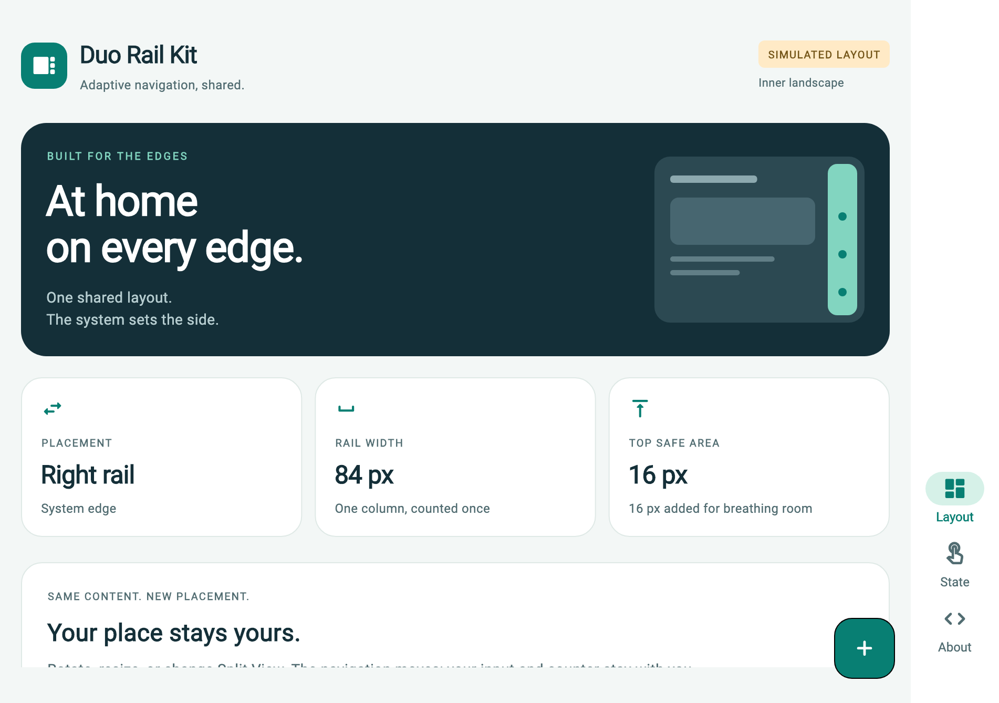

# duo_rail_kit

A Flutter plugin for placing custom navigation rails on the physical edge chosen
by iOS on iPhone Duo, with shared safe-area and floating-action-button helpers.
Applications retain their own navigation, appearance, breakpoints, and content.
The only runtime dependency is Flutter.

MIT licensed and publicly available on GitHub. Version 0.1.0 is not published
on pub.dev; publishing there remains a separate step. See the
[publication checklist](https://github.com/zawasystem/duo_rail_kit/blob/main/docs/publication.md).



*Flutter-rendered example with simulated insets; not native device captures.*
[Right rail](doc/images/duo-right.png) ·
[Left Split View rail](doc/images/split-left.png) ·
[Phone layout](doc/images/phone.png)

## Requirements

- Package constraints: Flutter `>=3.47.8` and Dart `^3.12.0`. Development uses
  Flutter 3.47.8, selected by `.fvmrc`; other SDK versions need validation.
- iOS integration: Swift Package Manager, with an iOS deployment target of at
  least 15.0. CocoaPods integration is not provided.
- Native compilation: Xcode with the iOS 27.1 SDK, which declares
  `UITraitCollection.verticalBarEdge`. Runtime access is guarded for iOS 27.1.
- Other platforms use the application's width-based rail rule; the package has
  no Android native code.

Flutter's generated plugin registrant registers `DuoRailKitPlugin`. No manual
AppDelegate registration or application-specific Xcode project edits are needed.
The Swift package relies on Flutter's generated `FlutterFramework` package; it
is built through a Flutter iOS host, not directly with `swift build` in isolation.

## Installation

Use the `0.1.0` release tag from the public Git repository:

```yaml
dependencies:
  duo_rail_kit:
    git:
      url: https://github.com/zawasystem/duo_rail_kit.git
      ref: '0.1.0'
```

The HTTPS URL resolves without authentication on developer machines, in CI,
and for Dependabot. No package-specific GitHub App, secret, or private repository
access grant is needed. Commit the application's updated `pubspec.lock` so the
tag's resolved commit is reviewable and reproducible. See
[Git dependency access](https://github.com/zawasystem/duo_rail_kit/blob/main/docs/ci_authentication.md)
for CI setup and removal of the former private-repository authentication.

For local package development, replace the `git` entry with
`path: ../duo_rail_kit`, adjusted for your directory layout.

## Root integration

Wrap the application once, in this order:

```dart
import 'package:duo_rail_kit/duo_rail_kit.dart';
import 'package:flutter/material.dart';

MaterialApp(
  builder: (context, child) => VerticalBarEdge(
    child: SideStatusBarInsets(child: child ?? const SizedBox.shrink()),
  ),
  home: const Scaffold(body: Center(child: Text('Hello'))),
);
```

`SideStatusBarInsets` must be below `VerticalBarEdge`, because it reads the system
edge when the window has no horizontal safe-area column. Keep these wrappers
mounted even when the device or layout changes. Changing the wrapper structure
can recreate navigation and page state.

## Run the example

The [example app](example/README.md) includes iOS and Android hosts:

```sh
cd example
fvm flutter pub get
fvm flutter run
```

Its Layout, State, and About destinations demonstrate rail placement,
safe areas, FAB positioning, and state preservation. Normal launches read the
actual native edge and fall back to a 600-point width rule. The separate
`DuoRailPreviewApp` fixture supplies simulated geometry for tests and the images
above; it is not evidence of native event delivery. See
[example/lib/app.dart](example/lib/app.dart) for the complete integration.

## API overview

| API | Purpose |
| --- | --- |
| `VerticalBarEdge` / `VerticalBarEdgeScope` | Observe the native edge and expose it to descendants. |
| `HorizontalEdge` | A physical screen edge: `left` or `right`. |
| `SideStatusBarInsets` | Apply the top-only Duo spacing rule and expose the added inset. |
| `RailPlacement` | Select an edge, calculate occupied width, and prepare rail safe areas. |
| `RailSideRow` | Place a rail beside keyed content without changing the content's position in the widget tree. |
| `RailSideFab` / `RailSideFabLocation` | Opt in to a consistent FAB bottom margin beside a bottom-aligned rail. |

### Selecting and laying out a rail

Read placement from the shell context, before changing content insets:

```dart
final placement = RailPlacement.of(
  context,
  showsRailByWidth: (windowWidth) => windowWidth >= 600,
);
final railSafeArea = RailPlacement.railSafeAreaOf(
  context,
  receivesAddedTop: false,
);
final railWidth = placement?.followsSystemBar == true
    ? RailPlacement.statusColumnWidth
    : 80.0;
final occupiedWidth = placement?.occupiedWidth(railSafeArea, railWidth) ?? 0.0;
final railPadding = placement?.centredRailSafeArea(railSafeArea) ?? railSafeArea;
```

The breakpoint and ordinary rail width above are example application choices.
An OS edge takes precedence over the width rule. Without one, the width rule
selects a left rail or no rail. The width rule receives the full window width,
not a pane's layout constraints.

Use `RailSideRow(railEdge: placement?.edge, rail: rail, content: content)` to keep
the content in a stable keyed slot. Size the rail's outer box to `occupiedWidth`,
pass `railPadding` through the rail's `MediaQuery`, and prevent the content from
counting the already occupied horizontal inset a second time. Keep application
wrappers around the content stable as placement changes. `RailSideRow` does not
adjust safe areas, render a rail, or implement navigation on its own.

Use the unmodified `railSafeArea` with `occupiedWidth`. Use
`centredRailSafeArea(railSafeArea)` for a vertically centered rail and for any
bottom-aligned item group that can grow into the system status display (large
text, many destinations, or a keyboard-shortened window). It clears the rail's
own horizontal inset and reserves the top status band only when that column
exists and the status bar is visible. Make tall rails scrollable, for example
with `NavigationRail(scrollable: true)`.

Applications that omit `centredRailSafeArea` must handle the rail's own horizontal
inset and verify that their item group remains below the status display at all
supported text sizes and keyboard heights. Styling, labels, alignment, grids,
SnackBars, overlays, and content/FAB avoidance remain application responsibilities.

### Physical edges and measured geometry

Native leading/trailing values are converted using UIKit's layout direction.
All rail APIs then use physical left/right. `RailSideRow` fixes the row layout to
LTR while preserving the content's own text direction.

The existing geometry is based on iOS 27.1 simulator measurements:

| Duo configuration | System edge and column |
| --- | --- |
| Outer portrait / inner landscape | Right, with an 84-point column. |
| Outer landscape | Left or right, with an 84-point column and hidden status bar. |
| Split View, left window | Left, without a horizontal status column. |
| Split View, right window | Right, with an 84-point column. |
| Inner portrait | No vertical edge; application width rule applies. |

`RailPlacement.statusColumnWidth` is 84 logical pixels.
`RailPlacement.statusColumnBottom` is 152: a conservative common lower boundary
for the visible status display. It may reserve more space than necessary on the
inner display. These are measured constants, not dynamically reported dimensions.

### Top safe-area spacing

`SideStatusBarInsets` raises only the top `MediaQuery.padding` and `viewPadding`
to at least 16 when the original top is zero and either:

- Exactly one horizontal edge has a safe-area inset; or
- Both horizontal insets are zero and the native vertical edge is present.

This is a geometry rule, not a device-model lookup. Left, right, and bottom are
unchanged. Shapes with two horizontal insets, such as ordinary landscape iPhones,
are excluded even if a vertical edge is reported.

`addedOf` reports the added top inset; `isActiveOf` reports whether any inset was
added. `removeAdded` restores the underlying OS values. An active inset does not
necessarily mean a horizontal status column exists: the left Split View window
also receives top spacing.

`railSafeAreaOf(receivesAddedTop: false)` restores OS insets for the rail. With
`true`, the rail receives the added top only for a one-sided-column shape, never
for the left Split View window without a column.

### FAB placement

Always wrap the shell content in `RailSideFab`, and change only its `enabled`
value. Enable it beside a bottom-aligned rail following the system edge:

```dart
RailSideFab(
  enabled: placement?.followsSystemBar ?? false,
  child: Builder(
    builder: (context) => Scaffold(
      floatingActionButtonLocation: RailSideFab.locationOf(context),
      floatingActionButton: FloatingActionButton(
        onPressed: () {},
        child: const Icon(Icons.add),
      ),
    ),
  ),
);
```

The FAB bottom is 24 logical pixels above the Scaffold's `contentBottom` (which
may be the keyboard or an application-owned panel). The bottom safe-area inset
is not added: with an inset of 34, the FAB overlaps that band by 10. Horizontal
placement follows Flutter's standard `endFloat`, including RTL behavior.
Keep the constant location returned by `locationOf`; replacing it with a fresh
location object can trigger an unwanted Scaffold FAB transition. Applications
can use `enabledOf` to keep their content clear of the FAB.

## Native contract and limitations

- Channel: `com.zawasystem.fleet/vertical_bar_edge`.
- Request: `getEdge`; notification: `edgeChanged`.
- Payload: `{edge: "left" | "right" | "none", statusBarHidden: bool, sequence: int}`.
- Dart applies only newer sequence numbers. Request replies and trait events can
  arrive out of order; arrival order must not replace sequence ordering.
- The first frame has no native edge and uses the width rule. The column-free
  left Split View window receives its top spacing after the first native reply;
  a one-sided-column window can receive spacing immediately from its geometry.
- `statusBarHidden` is sampled on queries and trait changes, not independently
  observed. Dart queries again on size/view-padding changes and app resume.
  A visibility-only change can remain stale until the next refresh.
- Missing plugin/channel errors fall back to width-based placement. Successful
  Dart tests alone therefore do not prove that native registration works.

## Development and validation

Run from this repository's root:

```sh
fvm flutter pub get
fvm flutter analyze
fvm flutter test
```

On macOS with Xcode 27.1 or newer and the matching iOS Simulator SDK:

```sh
fvm exec bash tool/build_ios_host.sh
```

The script creates a temporary iOS-only Flutter host, explicitly enables SPM in
that host's pubspec, adds this package as a local dependency, and copies the
example entrypoint. It builds an unsigned debug simulator app and checks the
generated SPM manifest, `GeneratedPluginRegistrant`, and defined symbols for the
plugin class and registration method in the compiled app. It removes the host
on exit, including failed builds. It does not install, launch, or remove any
application on a device or simulator.

The tests cover geometry, stable widget state, RTL, asynchronous event ordering,
safe-area behavior, FAB positioning, and the Dart/Swift channel contract. The
source-level Swift tests do not compile or execute native code; the host check
adds compilation and link validation. It does not prove runtime event delivery.
Use simulator/device checks for native events, rotation, folding, Split View, and
the status display before releasing an integration.

### CI and native builds

The [CI workflow](https://github.com/zawasystem/duo_rail_kit/blob/main/.github/workflows/ci.yml) runs package and example checks on
Ubuntu. Native compilation is manual: dispatch the workflow from `main` with
`native_ios` enabled. It uses a GitHub-hosted macOS runner and fails explicitly
if the required iOS 27.1 SDK is unavailable. Native jobs do not run automatically
on pushes or pull requests.

A configured workflow does not establish a successful run: check its result for
the commit being integrated. Dated verification results and remaining checks
are recorded in the [publication checklist](https://github.com/zawasystem/duo_rail_kit/blob/main/docs/publication.md).

Public pull requests must use an isolated hosted or ephemeral environment.
Do not run untrusted pull-request code on a persistent self-hosted runner or
expose credentials to it. Review runner access and SDK availability before
enabling native jobs. Consumers' private repositories retain their own CI billing
and access requirements; public package access does not change those settings.

## Contributing and release preparation

See [CONTRIBUTING.md](CONTRIBUTING.md) for the development workflow,
[MIGRATION.md](https://github.com/zawasystem/duo_rail_kit/blob/main/MIGRATION.md) for the extraction boundary and consumer migration,
and [CHANGELOG.md](CHANGELOG.md) for package changes. Publication checks and the
current validation record are in [docs/publication.md](https://github.com/zawasystem/duo_rail_kit/blob/main/docs/publication.md).

Security reporting is described in [SECURITY.md](SECURITY.md).
The package is licensed under the [MIT License](LICENSE). Flutter template and
rendered font/icon attributions are in [THIRD_PARTY_NOTICES.md](THIRD_PARTY_NOTICES.md).
